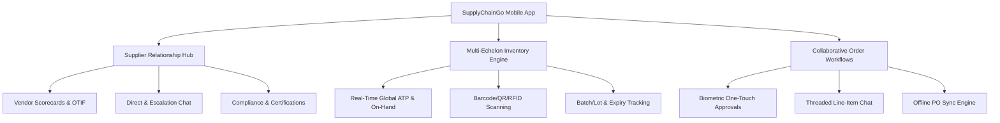
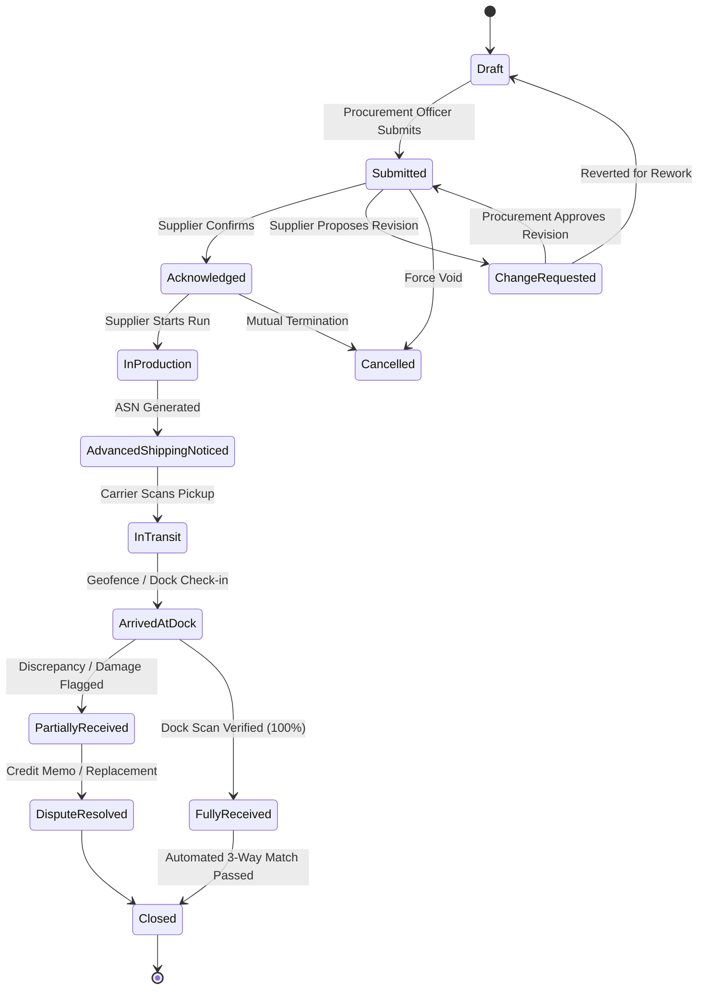
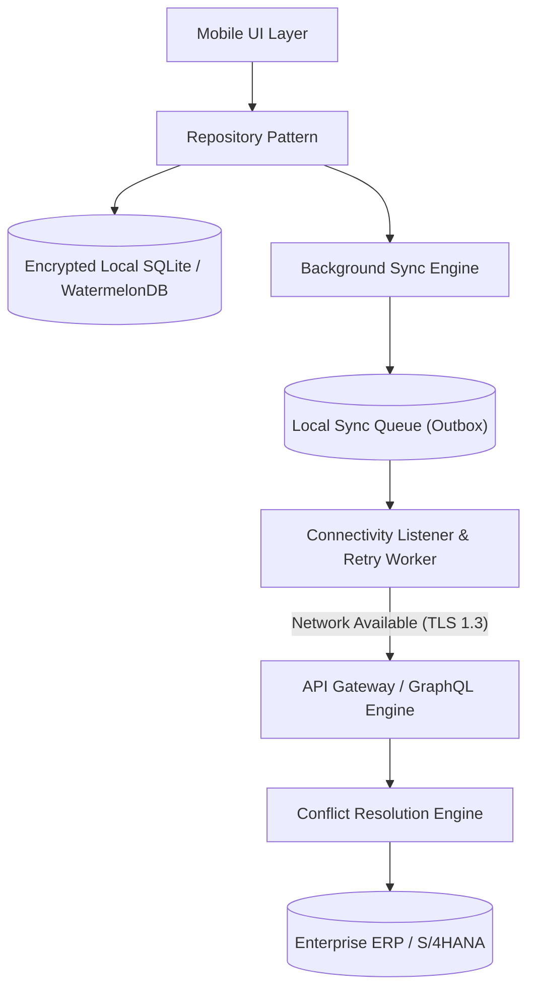
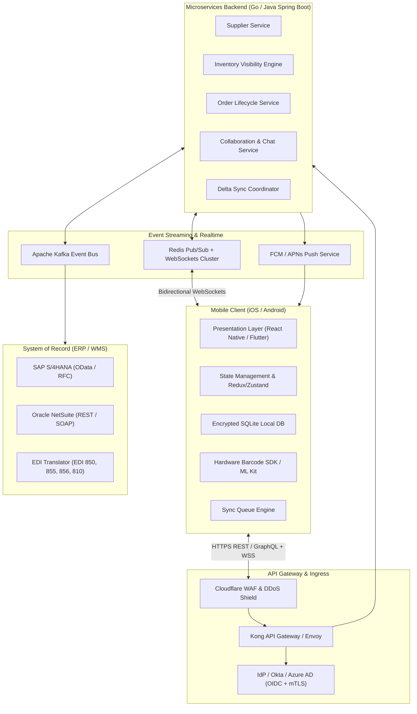
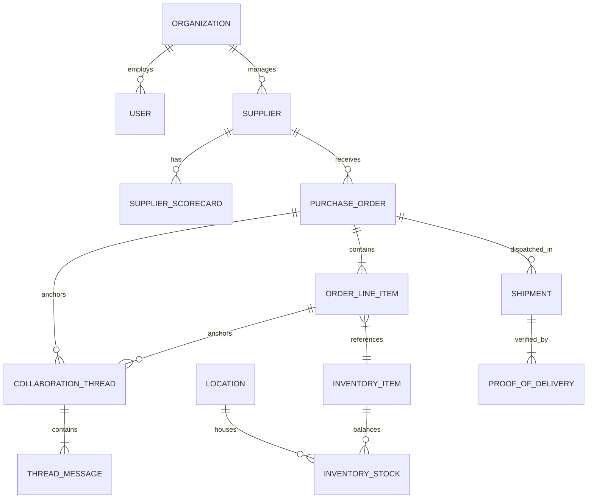
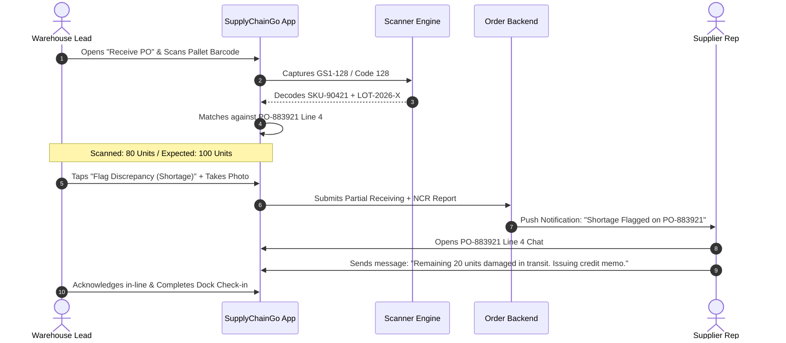
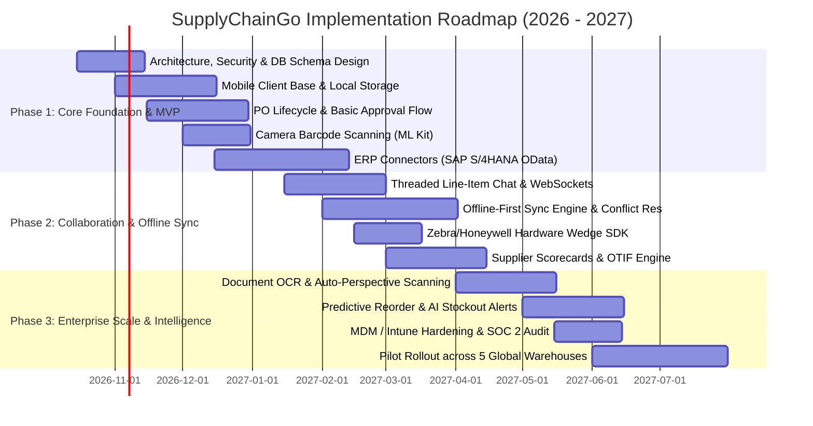

# Product & Technical Specification: Enterprise Mobile Supply Chain Platform ("SupplyChainGo")

**Document Version:** 1.0.0  
**Target Release:** Q3 2026  
**Status:** Approved for Implementation  
**Classification:** Enterprise B2B Confidential  

---

## 1. Executive Summary & Product Vision

### 1.1 Objective
SupplyChainGo is a high-reliability, mobile-first supply chain execution application engineered for procurement managers, warehouse leads, field operations, and external tier-1/tier-2 suppliers. The application unifies three critical operational pillars into a single native mobile interface:
1. **Supplier Relationship Management (SRM):** Real-time supplier performance scorecards, direct messaging channels, compliance validation, and contract visibility.
2. **Real-Time Multi-Echelon Inventory Visibility:** Instant visibility across global distribution centers (DCs), regional warehouses, in-transit shipments, and retail nodes with camera/hardware barcode scanning.
3. **Collaborative Order Lifecycle Execution:** Contextual, thread-based collaboration on purchase orders (POs) and change requests from any mobile device, complete with offline-first synchronization and biometric approvals.



### 1.2 Target Business Metrics (KPIs)
* **On-Time In-Full (OTIF) Delivery:** Increase by 18% within 6 months of rollout.
* **PO Exception Resolution Cycle Time:** Reduce from an average of 48 hours to under 3.5 hours.
* **Warehouse Receiving Discrepancy Rate:** Lower from 4.2% to <0.6% using mobile barcode receiving verification.
* **Inventory Stockout Incidents:** Reduce emergency stockouts by 27% via proactive mobile reorder push alerts.

---

## 2. Personas, Roles & Access Control (RBAC/ABAC)

The system enforces strict Role-Based (RBAC) and Attribute-Based Access Control (ABAC) to segregate internal enterprise operations from external supplier networks.

| Role | Primary User / Persona | Target Environment | Key Permissions |
| :--- | :--- | :--- | :--- |
| **Procurement Specialist** | Sourcing & Buyer Leads | Corporate / Remote Mobile | Create/Approve POs, Negotiate pricing, Access supplier scorecards, Manage contracts |
| **Warehouse Lead** | Plant Managers, Dock Supervisors | Warehouse Rugged Devices / Tablets | Adjust inventory, Receive goods, Scan barcodes, Flag damaged goods, View local ATP |
| **Supplier Representative** | Tier-1/2 Account Reps, Dispatchers | External iOS/Android Mobile | Acknowledge POs, Issue Advanced Shipping Notices (ASNs), Chat in PO threads, Upload BOLs |
| **Logistics/Field Agent** | Freight Carriers, 3PL Drivers | In-transit / Freight Docks | Update shipment milestones, Capture Proof of Delivery (PoD) signatures, Scan lot tags |
| **Executive / Director** | VP of Supply Chain, COO | Mobile Executive Dashboard | High-level KPI aggregations, Exception escalation overrides, Audit inspection |

### 2.1 Permission Matrix

| Resource | Procurement Lead | Warehouse Lead | Supplier Rep | Field Carrier |
| :--- | :--- | :--- | :--- | :--- |
| **Supplier Scorecards** | Read / Write | Read Only | Read (Self Only) | None |
| **Inventory (Global)** | Read Only | Read / Write (Assigned Node) | Read (Assigned Consignment) | None |
| **Purchase Orders** | Full CRUD + Approve | Read / Update Receiving | Read / Acknowledge / Propose Change | Read Milestone Only |
| **Line-Item Chat** | Read / Write / Mention | Read / Write / Mention | Read / Write (Assigned POs) | Read / Write (Delivery Notes) |
| **Pricing / Cost Data** | Full Read / Write | Hidden | Restricted (Own POs) | Hidden |

---

## 3. Core Functional Modules & Technical Requirements

### 3.1 Module 1: Supplier Relationship Management (SRM) & Directory

#### 3.1.1 Supplier Profiles & Tiering
* Centralized mobile directory searchable by Vendor ID, Category, Geography, Tier (Strategic, Preferred, Tactical), and Operational Status.
* Document vault for suppliers: NDAs, Quality Certifications (ISO 9001, ESG audits), insurance certificates with automated expiration alerts.

#### 3.1.2 Real-Time Vendor Scorecard & Operational Telemetry
* Dynamic calculation of supplier health scores displayed as visual micro-charts on mobile:
  * **OTIF Score:** Real-time percentage calculated over trailing 30, 90, and 365 days.
  * **Quality Defect Rate (PPM):** Parts-per-million rejected at dock inspection.
  * **Average Acknowledgement Time:** Mean time to confirm PO issue.
  * **Lead Time Drift:** Deviation (in days) between committed delivery dates vs. actual dock arrival dates.
* **Supplier Alert Banner:** Automated flags displayed on PO screens if a vendor's OTIF drops below 85% or if active quality disputes exist.

#### 3.1.3 Vendor Escalations & Incident Management
* In-app dispute lodging: Procurement or Warehouse leads can initiate a non-conformance report (NCR) directly from a mobile device with attached photographic proof.
* Automated assignment to the supplier's primary account representative with a 4-hour SLA acknowledgment timer.

---

### 3.2 Module 2: Real-Time Multi-Echelon Inventory Visibility

#### 3.2.1 Multi-Echelon Stock Status Logic
The mobile engine surfaces inventory aggregated across three echelons: Regional Distribution Centers (RDCs), Local Hubs, and In-Transit Nodes.

For every SKU, the following states are computed and exposed:
$$\text{Available to Promise (ATP)} = \text{On Hand} + \text{In Transit (Sched. < 48h)} - \text{Hard Allocations} - \text{Safety Stock Reserves}$$

```
+-----------------------------------------------------------------------------------+
| SKU-90421: High-Performance Servo Valve                                            |
| Total Enterprise Visibility: 12,450 Units                                         |
+------------------------------------+----------------------------------------------+
| • On Hand (Physical): 8,200        | • Reserved / Allocated: 3,100               |
| • Available to Promise (ATP): 5,100| • In Transit (ETA < 48h): 4,250              |
| • Safety Stock Floor: 1,500        | • Quarantine / Damaged: 120                  |
+------------------------------------+----------------------------------------------+
```

#### 3.2.2 Barcode, QR & RFID Hardware Scanning Engine
* **Camera Scanning:** Integrated native camera scanning utilizing ML Kit (Vision API on Android and Vision Framework on iOS) supporting EAN-13, UPC-A, Code 128, DataMatrix, and QR codes at $\ge 60\text{ fps}$.
* **Enterprise Hardware Wedge Support:** Zero-latency native bridge for dedicated enterprise scanners:
  * Zebra DataWedge API (broadcast intent receiver).
  * Honeywell Mobility Edge Scanner SDK.
  * Keyence & Bluetooth Ring Scanners (SPP/HID profile integration).
* **Batch Receiving Mode:** Continuous scanning workflow allowing operators to scan pallets without touching the screen; audio/haptic confirmation on valid reads, distinctive error buzzer on unexpected SKUs or over-shipments.

#### 3.2.3 Lot, Batch, Serial & Expiration Date Management
* Strict serialization support for regulated industries (Aerospace, Pharma, Food & Beverage).
* First-Expired, First-Out (FEFO) and First-In, First-Out (FIFO) indicators highlighted during pick/pack and dock inspection.
* Temperature-controlled tag telemetry integration: surfaces IoT sensor threshold alerts (e.g., cold chain temperature excursions).

---

### 3.3 Module 3: Collaborative Purchase Order (PO) & Order Lifecycle

#### 3.3.1 PO Finite State Machine (FSM)



#### 3.3.2 Mobile-First Approval Workflows
* **Biometric Step-Up Authorization:** Orders exceeding configured monetary thresholds (e.g., $>\$50,000$) require Face ID / Fingerprint re-authentication to prevent accidental or unauthorized approvals.
* **One-Touch Bulk Approval:** Procurement executives can review batch PO summaries and execute batch signing with cryptographic audit stamps.
* **Dynamic Approval Routing:** Workflows automatically fork based on total PO value, cost center, and supplier tier.

#### 3.3.3 Contextual Collaboration & Line-Item Threads
* **Granular Message Anchoring:** Chat conversations are anchored not just to the PO header, but to specific line items (e.g., "Thread on Line Item #3: SKU-90421").
* **Rich In-Line Proposals:** Suppliers can tap "Propose Change" on a line item to alter quantity, delivery date, or unit cost. The app renders a side-by-side diff widget directly in the conversation thread with one-tap "Accept" or "Reject" buttons for the buyer.
* **@Mentions & Role Paging:** Supports `@supplier_dispatcher`, `@dock_supervisor`, or individual team members, triggering high-priority push notifications.

```
+-----------------------------------------------------------------------------------+
| PO-883921 • Line 4 (Stainless Flange Bolt M12)                                    |
+-----------------------------------------------------------------------------------+
| [Supplier Rep - Carlos] 10:14 AM                                                  |
| Due to raw material delays, we can only supply 800 of the requested 1,000 units   |
| by Oct 15. The remaining 200 can arrive on Oct 22.                                |
|                                                                                   |
| +-------------------------------------------------------------------------------+ |
| | PROPOSED CHANGE REQUEST: Split Delivery                                       | |
| | - Split 1: 800 Units | New Date: Oct 15, 2026                                 | |
| | - Split 2: 200 Units | New Date: Oct 22, 2026                                 | |
| | [ACCEPT PROPOSAL]                      [COUNTER-PROPOSAL]                     | |
| +-------------------------------------------------------------------------------+ |
|                                                                                   |
| [Procurement - Sarah] 10:18 AM                                                    |
| @carlos Accepted Split 1. Plant 4 can operate on 800 units for that week.         |
+-----------------------------------------------------------------------------------+
```

---

### 3.4 Module 4: Proof of Delivery (PoD) & Document Intelligence

* **Document Capture & Perspective Correction:** In-app camera module detects paper boundaries (Bills of Lading, Packing Slips, Commercial Invoices) and applies automatic perspective deskewing and contrast enhancement.
* **Edge OCR Extraction:** Automatic text recognition extracts Tracking Numbers, PO Numbers, and Seal Numbers directly on the client device prior to network upload.
* **Digital Signatures:** Touch-based signature pad capturing carrier and receiving agent signatures, embedded with timestamp and GPS geolocation coordinates.

---

### 3.5 Module 5: Offline-First Operation & Data Sync Architecture

Warehouses, tarmac docks, and transit yards frequently suffer from cellular dead-zones and metallic Wi-Fi attenuation. SupplyChainGo is architected as an **Offline-First system**.



#### 3.5.1 Local Persistence Engine
* Local database powered by SQLite (via WatermelonDB or Room/CoreData) with SQLCipher 256-bit AES encryption.
* Fast read access with indexed queries guaranteeing $<16\text{ ms}$ query latency for local catalogs of up to 100,000 SKUs.

#### 3.5.2 Synchronization Protocol & Conflict Resolution
* **Sync Strategy:** Delta synchronization using monotonic sequence vectors and timestamps ($T_{server}, T_{client}$).
* **Mutation Outbox:** All writes (scans, comments, status transitions, approvals) are written synchronously to the local database and enqueued into a persistent `sync_outbox` table before network dispatch.
* **Deterministic Conflict Resolution Policies:**

| Mutation Type | Conflict Scenario | Resolution Rule |
| :--- | :--- | :--- |
| **PO Line Comments** | Two users comment while one is offline | **Deterministic Append:** Merged sequentially using server timestamp order. |
| **PO Status Transition** | Procurement cancels PO while Supplier acknowledges offline | **Pessimistic Invalidation:** Server state prevails; offline user is notified with an immediate resolution prompt. |
| **Inventory Count / Scan** | Multiple warehouse leads cycle-count the same location concurrently | **Delta Accumulation ($+\Delta, -\Delta$):** Absolute values are recalculated using algebraic delta accumulation. |
| **Line Item Quantity** | Price or quantity updated concurrently | **Three-Way Merge:** Rejects conflicting updates and alerts both parties to review the diff. |

---

## 4. Technical Architecture & System Design

### 4.1 System Topology



### 4.2 Mobile Client Technology Stack

* **Platform Framework:** **React Native (v0.75+ with New Architecture / TurboModules)** OR **Flutter (v3.24+)**.  
  * *Selected Default: React Native + TypeScript.* (Provides optimal integration with enterprise web portals and native hardware scanners via JSI/TurboModules).
* **Local Database:** WatermelonDB over SQLite with SQLCipher encryption.
* **State Management:** Zustand (for transient UI state) + TanStack Query (React Query) for server state caching.
* **Real-time Protocol:** WSS (WebSocket Secure) with automatic fallback to Server-Sent Events (SSE) or long-polling behind strict enterprise corporate firewalls.
* **Push Notifications:** Firebase Cloud Messaging (FCM) on Android and Apple Push Notification service (APNs) on iOS via Unified Push Gateway.

### 4.3 Backend & Integration Specifications

* **Microservices Framework:** Go (Golang 1.23) for high-concurrency event ingestion (barcode scanning, WebSocket hubs) and Java (Spring Boot 3.3) for transactional ERP orchestration.
* **Database Layer:** 
  * Primary Transactional: Amazon Aurora PostgreSQL (Multi-Region with row-level security).
  * High-Throughput Inventory Cache: Redis Cluster (Enterprise Active-Active).
  * Event Streaming & Change Data Capture (CDC): Apache Kafka + Debezium.
* **ERP Connectors:**
  * **SAP S/4HANA:** Direct integration via SAP Cloud SDK using OData v4 and BAPI RFCs.
  * **EDI Gateway:** Native bi-directional transformation for standard X12 transactions:
    * `EDI 850`: Purchase Order Inbound/Outbound.
    * `EDI 855`: Purchase Order Acknowledgment.
    * `EDI 856`: Ship Notice / Manifest (ASN).
    * `EDI 860`: Purchase Order Change Request.

---

## 5. Comprehensive Data Models & Schemas

### 5.1 Entity Relationship Diagram



### 5.2 Core JSON Schema Specifications

#### 5.2.1 Purchase Order Entity Schema (`po.schema.json`)
```json
{
  "$schema": "http://json-schema.org/draft-07/schema#",
  "title": "PurchaseOrder",
  "type": "object",
  "required": [
    "poId",
    "poNumber",
    "buyerOrgId",
    "supplierId",
    "status",
    "currency",
    "totalAmount",
    "lineItems",
    "createdAt",
    "updatedAt"
  ],
  "properties": {
    "poId": { "type": "string", "format": "uuid" },
    "poNumber": { "type": "string", "pattern": "^PO-[0-9]{6,10}$" },
    "buyerOrgId": { "type": "string", "format": "uuid" },
    "supplierId": { "type": "string", "format": "uuid" },
    "status": {
      "type": "string",
      "enum": [
        "DRAFT",
        "SUBMITTED",
        "ACKNOWLEDGED",
        "CHANGE_REQUESTED",
        "IN_PRODUCTION",
        "ASN_ISSUED",
        "IN_TRANSIT",
        "ARRIVED_AT_DOCK",
        "PARTIALLY_RECEIVED",
        "FULLY_RECEIVED",
        "CLOSED",
        "CANCELLED"
      ]
    },
    "currency": { "type": "string", "minLength": 3, "maxLength": 3 },
    "totalAmount": { "type": "number", "minimum": 0 },
    "incoterms": { "type": "string", "enum": ["FOB", "CIF", "DDP", "EXW", "FCA"] },
    "requiredDeliveryDate": { "type": "string", "format": "date-time" },
    "lineItems": {
      "type": "array",
      "minItems": 1,
      "items": {
        "type": "object",
        "required": ["lineNumber", "sku", "description", "orderedQuantity", "unitPrice", "unitOfMeasure"],
        "properties": {
          "lineItemId": { "type": "string", "format": "uuid" },
          "lineNumber": { "type": "integer", "minimum": 1 },
          "sku": { "type": "string" },
          "description": { "type": "string" },
          "orderedQuantity": { "type": "number", "minimum": 0.001 },
          "receivedQuantity": { "type": "number", "default": 0 },
          "unitPrice": { "type": "number", "minimum": 0 },
          "unitOfMeasure": { "type": "string" },
          "lotNumber": { "type": ["string", "null"] },
          "expiryDate": { "type": ["string", "null"], "format": "date" },
          "changeProposal": {
            "type": ["object", "null"],
            "properties": {
              "proposedQuantity": { "type": "number" },
              "proposedDeliveryDate": { "type": "string", "format": "date-time" },
              "proposedUnitPrice": { "type": "number" },
              "reason": { "type": "string" },
              "proposedByUserId": { "type": "string", "format": "uuid" },
              "proposedAt": { "type": "string", "format": "date-time" }
            }
          }
        }
      }
    },
    "auditTrail": {
      "type": "array",
      "items": {
        "type": "object",
        "properties": {
          "action": { "type": "string" },
          "userId": { "type": "string", "format": "uuid" },
          "timestamp": { "type": "string", "format": "date-time" },
          "metadata": { "type": "object" }
        }
      }
    }
  }
}
```

#### 5.2.2 Inventory Stock Position Schema (`inventory.schema.json`)
```json
{
  "$schema": "http://json-schema.org/draft-07/schema#",
  "title": "InventoryStockPosition",
  "type": "object",
  "required": [
    "sku",
    "locationId",
    "onHand",
    "allocated",
    "inTransit",
    "safetyStock",
    "atp",
    "updatedAt"
  ],
  "properties": {
    "sku": { "type": "string" },
    "locationId": { "type": "string", "format": "uuid" },
    "locationCode": { "type": "string" },
    "locationType": { "type": "string", "enum": ["DC", "REGIONAL_HUB", "PLANT", "IN_TRANSIT"] },
    "onHand": { "type": "number", "minimum": 0 },
    "allocated": { "type": "number", "minimum": 0 },
    "inTransit": { "type": "number", "minimum": 0 },
    "safetyStock": { "type": "number", "minimum": 0 },
    "atp": { "type": "number" },
    "batches": {
      "type": "array",
      "items": {
        "type": "object",
        "properties": {
          "batchNumber": { "type": "string" },
          "quantity": { "type": "number" },
          "expiryDate": { "type": "string", "format": "date" },
          "qaStatus": { "type": "string", "enum": ["RELEASED", "QUARANTINE", "REJECTED"] }
        }
      }
    },
    "updatedAt": { "type": "string", "format": "date-time" }
  }
}
```

---

## 6. API Endpoints & Real-Time Protocol Contracts

All REST operations require:
* `Authorization: Bearer <JWT_TOKEN>`
* `X-Device-Id: <UUID>`
* `X-Idempotency-Key: <UUID>` (for all POST/PUT/PATCH requests)

### 6.1 Core API Endpoints

#### `POST /api/v1/orders/{poId}/approve`
Approves a purchase order with biometric cryptostamp verification.
* **Request:**
  ```json
  {
    "biometricAuthProof": "MEQCIFz9J...signature_token...",
    "deviceAttestation": "apple-app-attest-token-or-play-integrity",
    "comment": "Approved for emergency plant shutdown replenishment."
  }
  ```
* **Response:** `200 OK`
  ```json
  {
    "poId": "8f31b67f-4421-4f11-8973-c62589e63e12",
    "status": "APPROVED",
    "approvedAt": "2026-10-10T14:32:00Z",
    "auditRecordId": "aud-991283"
  }
  ```

#### `GET /api/v1/inventory/lookup`
High-speed lookup supporting barcode, QR, or text query with multi-node aggregation.
* **Parameters:** `query=079357318921&includeTransit=true&radiusKm=200&geoLat=34.05&geoLong=-118.24`
* **Response:** `200 OK`
  ```json
  {
    "sku": "SKU-90421",
    "upc": "079357318921",
    "name": "High-Performance Servo Valve",
    "globalAtp": 5100,
    "nodes": [
      {
        "locationCode": "DC-WEST-01",
        "name": "Ontario Logistics Hub",
        "distanceKm": 48.2,
        "onHand": 4200,
        "availableToPromise": 2800,
        "inTransitIncoming": 1000
      },
      {
        "locationCode": "PLANT-04",
        "name": "Bakersfield Assembly",
        "distanceKm": 162.0,
        "onHand": 1200,
        "availableToPromise": 900,
        "inTransitIncoming": 0
      }
    ]
  }
  ```

#### `POST /api/v1/sync/delta`
Sync payload exchange for offline client synchronization.
* **Request:**
  ```json
  {
    "clientLastSyncSequence": 108429,
    "mutations": [
      {
        "mutationId": "9b1deb4d-3b7d-4bad-9bdd-2b0d7b3dcb6d",
        "entity": "PURCHASE_ORDER_RECEIPT",
        "action": "PARTIAL_RECEIVE_SCAN",
        "timestamp": "2026-10-10T14:15:22Z",
        "payload": {
          "poId": "8f31b67f-4421-4f11-8973-c62589e63e12",
          "lineItemId": "7c23a54d-1234-4567-8901-abcdef012345",
          "scannedQty": 150,
          "barcodeFormat": "CODE_128",
          "lotNumber": "LOT-2026-X"
        }
      }
    ]
  }
  ```
* **Response:** `200 OK`
  ```json
  {
    "serverSyncSequence": 108488,
    "processedMutations": [
      { "mutationId": "9b1deb4d-3b7d-4bad-9bdd-2b0d7b3dcb6d", "status": "ACKNOWLEDGED" }
    ],
    "incomingServerDeltas": [
      {
        "entity": "THREAD_MESSAGE",
        "action": "INSERT",
        "payload": {
          "messageId": "msg-88129",
          "threadId": "thr-po-8f31",
          "sender": "Carlos Mendez",
          "content": "Carrier is at Gate 4.",
          "createdAt": "2026-10-10T14:28:11Z"
        }
      }
    ]
  }
  ```

### 6.2 WebSocket Real-Time Event Protocol
The client establishes a persistent connection to `wss://stream.supplychain.company.com/v1/events`:

* **Client Subscription Frame:**
  ```json
  {
    "action": "SUBSCRIBE",
    "channels": [
      "org:org-881:inventory_alerts",
      "po:8f31b67f-4421-4f11-8973-c62589e63e12:thread",
      "user:usr-1029:notifications"
    ]
  }
  ```

* **Server Push Event Frame (Inventory Depletion Warning):**
  ```json
  {
    "event": "INVENTORY_ALERT",
    "channel": "org:org-881:inventory_alerts",
    "payload": {
      "sku": "SKU-90421",
      "locationCode": "DC-WEST-01",
      "alertType": "STOCKOUT_WARNING",
      "previousAtp": 2800,
      "currentAtp": 350,
      "reorderThreshold": 500,
      "timestamp": "2026-10-10T14:30:00Z"
    }
  }
  ```

---

## 7. Security, Compliance & Device Governance

### 7.1 Authentication & Authorization
* **Single Sign-On (SSO):** SAML 2.0 / OIDC federation via Okta, Ping Identity, and Microsoft Entra ID.
* **Supplier Extranet Authentication:** Multi-factor passwordless authentication using WebAuthn / FIDO2 Passkeys and SMS/Email magic link fallbacks.
* **Token Architecture:** Short-lived access tokens (15-minute JWT) with rolling refresh tokens secured in iOS Keychain / Android Keystore with biometric access control flags (`kSecAccessControlBiometryAny` / `BiometricPrompt`).

### 7.2 Zero-Trust Device Security & MDM
* **App Shielding & Integrity:** Runtime application self-protection (RASP):
  * Automated detection of rooted (Android) or jailbroken (iOS) devices; blocks application execution if detected.
  * Integrity attestation via Apple App Attest and Google Play Integrity API.
  * Screen capture prevention (flag `FLAG_SECURE` on Android, overlay protection on iOS) on financial/pricing screens.
* **Mobile Device Management (MDM):** Pre-configured AppConfig support for enterprise deployments via Microsoft Intune, VMware Workspace ONE, and MobileIron. Supports remote data wipe of local offline databases upon employee offboarding.

### 7.3 Data Protection & Encryption
* **In-Transit:** TLS 1.3 only, enforcing modern cipher suites (AES-GCM / ChaCha20-Poly1305) with dynamic Public Key Pinning (HPKP).
* **At-Rest:** SQLCipher AES-256 for all local tables, key derived from native hardware-backed keystore/secure enclave.
* **Compliance Standards:** Built to meet SOC 2 Type II, ISO 27001, and GDPR Article 32 data privacy and audit trail specifications.

---

## 8. Mobile UX Architecture & Screen Workflows

### 8.1 Primary Screen Hierarchy & Information Architecture

```
App Root
├── [1] Home / Executive Dashboard
│   ├── KPI Summary Cards (OTIF %, Active Orders, Critical Stockouts)
│   ├── Quick Action Bar: [Scan Barcode] [New PO] [Urgent Chats]
│   └── Actionable Feeds (Awaiting Approval, Discrepancies)
├── [2] Inventory Hub
│   ├── Global SKU Search & Scan View
│   ├── Multi-Node Stock Matrix (On Hand, ATP, In Transit)
│   ├── Low-Stock & Reorder Alerts
│   └── Cycle Count & Stock Adjustment Flow
├── [3] Order Management (POs)
│   ├── Filtered Order List (Draft, In Transit, Needs Action)
│   ├── PO Detail View
│   │   ├── Status Stepper / Progress Bar
│   │   ├── Line Items Table (with expand/collapse details)
│   │   ├── Contextual Line-Item Chat Tab
│   │   ├── Tracking & ASN Timeline Tab
│   │   └── Documents & PoD Gallery
│   └── Biometric Approval Action Sheet
├── [4] Supplier Directory
│   ├── Vendor Index & Tiering Filter
│   ├── Supplier 360 Profile (Scorecard, Contacts, Active POs)
│   └── Direct Channel Messaging
└── [5] Settings & Sync Status
    ├── Offline Sync Queue Monitor (Pending / Failed / Synced)
    ├── Scanner Hardware Configuration (Zebra/Honeywell/Camera)
    └── Security & Biometric Preferences
```

### 8.2 End-to-End Receiving & Exception Workflow



---

## 9. Non-Functional Requirements & Performance SLAs

### 9.1 Performance Benchmarks
* **Cold App Launch Time:** $\le 1.8\text{ seconds}$ to interactive state on mid-tier mobile hardware (e.g., Samsung Galaxy A54 / iPhone 12).
* **Warm Launch / Resume:** $\le 400\text{ ms}$.
* **Barcode Scan-to-Match Latency:** $\le 80\text{ ms}$ (local SQLite match); $\le 350\text{ ms}$ for cold remote API queries.
* **Local Scroll Performance:** Constant 60 frames per second (fps) on high-density list views (10,000+ items with windowed virtualization).
* **Battery Consumption:** $< 3.5\%$ battery drain per 60 minutes of active hardware barcode scanning.

### 9.2 Reliability & Availability
* **Backend Uptime SLA:** $99.95\%$ monthly availability (excluding scheduled maintenance).
* **Offline Operation Resilience:** Complete operational autonomy for up to 72 consecutive hours offline; sync queue capacity for $\ge 50,000$ pending records.
* **Packet Footprint Optimization:** All sync payloads compressed with Brotli / Gzip; average payload size $< 12\text{ KB}$.

---

## 10. Phased Implementation Roadmap



### 10.1 Milestone Deliverables
* **Milestone 1 (MVP - End of Q4 2026):** Basic PO viewing, biometric approval, real-time inventory lookup via camera scanning, SAP PO integration.
* **Milestone 2 (Collaboration & Offline - End of Q1 2027):** Offline sync engine, line-item threaded chat with suppliers, Zebra/Honeywell barcode hardware wedge support, supplier scorecards.
* **Milestone 3 (Enterprise Scale & Production Rollout - End of Q2 2027):** Automated document OCR, complete EDI 850/856 translator, MDM compliance hardening, full pilot rollout.
